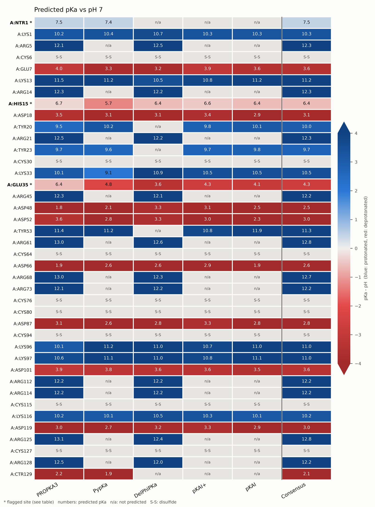

<b>This tutorial runs several protein pKa predictors on the same structure, merges their results into one table for every site with a variable protonation state, and assigns protonation states at a target pH by consensus, with AMBER and CHARMM residue names ready for system preparation. Hen egg-white lysozyme (PDB 4LZT) is used as the worked example.</b>

Before a protein can be simulated, every Asp, Glu, His, Cys, Tyr, Lys and Arg and both chain termini need a protonation state. For most of them the choice is obvious at neutral pH, but for a few, usually buried or catalytic residues and histidines, it is not, and different pKa predictors can disagree by several pH units. pka_compare.py runs the predictors on one cleaned structure, puts their pKa values side by side, calls a state per method and by consensus, and flags the sites where a decision has to be made by hand.

| Key | Method | Type | How it is run |
| :--- | :--- | :--- | :--- |
| propka | PROPKA3 | Empirical | Python API |
| pypka | PypKa | Poisson-Boltzmann + Monte Carlo (DelPhi) | Python API |
| delphipka | DelPhiPKa | Poisson-Boltzmann with a Gaussian dielectric (DelPhi) | delphiPKa executable, built from source |
| pkai+ | pKAI+ | Deep learning, biased towards experiment | Python API |
| pkai | pKAI | Deep learning surrogate of PypKa | Python API |
| deepka | DeepKa | 3D CNN trained on CpHMD pKa values | Results file or command template |
| mepka | ME-pKa | Multimodal (3D grid + ESM-2 embeddings) | Results file or command template |

| File | Description |
| :--- | :--- |
| <a href="pka_compare.py">pka_compare.py</a> | The pipeline: structure cleaning, predictors, consensus, flags, tables, heatmap and PDB with state names |
| <a href="create_pka_env.sh">create_pka_env.sh</a> | Builds a conda environment with every predictor, including DelPhiPKa compiled from source |
| <a href="example/4LZT.pdb">example/4LZT.pdb</a> | Triclinic hen egg-white lysozyme at 0.95 &Aring; (PDB 4LZT) |
| <a href="https://github.com/arvpinto/pka_compare/tree/main/example/4LZT_pka" target="_blank">example/4LZT_pka/</a> | Output of the lysozyme run shown below: summary, per-site table, heatmap and structures |
| <a href="https://github.com/arvpinto/pka_compare/tree/main/example/tleap" target="_blank">example/tleap/</a> | tleap input used to build the lysozyme topology from the state-named PDB |
| <a href="example/render_structure.py">example/render_structure.py</a> | PyMOL script for the picture at the top of this page |

---

<h2> 
 <b>I - How the pipeline works</b> 
</h2>

- 
<b>Cleaning.</b> One structure is written and given to every method: the first model only, one alternate location per atom (altloc A by default), no waters, no hydrogens and no HETATM records unless asked for. Cysteines whose SG atoms are within 2.5 &Aring; are marked as disulfides and not titrated. Metal ions are removed, because none of the predictors treats them reliably, and their ligands are flagged.

- 
<b>Predictors.</b> Each method runs in its own work directory. A method that is not installed or fails is reported as such, and the run continues with the others.

- 
<b>States per method.</b> The protonated fraction at the target pH follows Henderson-Hasselbalch from the method's pKa, except for PypKa and DelPhiPKa, whose own titration curves are interpolated at that pH (they already include site-site coupling). A state is P (protonated) or D (deprotonated) when that fraction is beyond the value set by --margin (0.91 or 0.09 for the default of 1 pH unit) and M (mixed) otherwise.

- 
<b>Consensus.</b> The consensus pKa is the median of the available predictions (or the mean, with --consensus mean). Consensus states within the margin of the target pH get a "?" (protonated?, HIE? ...). The neutral His tautomer is taken from the most populated PypKa tautomer when PypKa ran.

- 
<b>Flags.</b> CHECK marks sites that need a decision: within the margin of the pH, methods disagree on the state, a spread between methods of at least 2 pH units (--spread-warn), only one of several capable methods gave a value, no prediction at all, or a metal ligand. note is informative: a disulfide, a method that could have predicted the site but did not, PROPKA coupling, or an unresolved His tautomer.

- 
<b>Coverage.</b> The methods do not all predict the same site types: PROPKA3 predicts all nine; PypKa all but Arg; DelPhiPKa Asp, Glu, His, Lys and Arg (plus Tyr and Cys with --delphipka-more-residues), but not the termini; pKAI and pKAI+ Asp, Glu, His, Cys, Tyr and Lys; DeepKa and ME-pKa Asp, Glu, His and Lys. The consensus of a site uses whichever methods cover it.

<h2> 
 <b>II - Installation</b> 
</h2>

create_pka_env.sh builds everything in one environment with conda, mamba or micromamba on Linux x86_64. It installs Python 3.10 with PROPKA 3.5.1, PypKa 2.10.0 and pKAI 1.2.0 with a CPU build of PyTorch 1.13 from conda-forge, compiles DelPhiPKa from <a href="https://github.com/delphi001/DelPhiPKa" target="_blank">github.com/delphi001/DelPhiPKa</a>, installs pka_compare.py as a command and adds activation hooks that set LD_LIBRARY_PATH and DELPHIPKA_HOME. With --test it ends with a short run of every installed predictor:

<pre style="color: white; background-color: black;">
bash create_pka_env.sh -n pka_compare --torch cpu --test
conda activate pka_compare
</pre>

PypKa is the reason this is not a plain pip install: its compiled DelPhi bindings exist only up to Python 3.10 and need NumPy &lt; 2, the old libgfortran.so.4, gawk and a python2.7 executable on the PATH for its bundled pdb2pqr 2.x. The script puts a private python2.7 in $CONDA_PREFIX/opt/python27 and links it into the environment. pKAI needs PyTorch &lt; 2 (--torch cuda for a GPU build, --torch none to skip pKAI). DelPhiPKa is built against Open MPI 5, which no longer has the MPI C++ bindings that DelPhiPKa uses, so the script adds a small header (mpi_cxx_compat.h) that maps those calls onto the C API; on lysozyme this build gives the same pKa values as a build against Open MPI 4.1. --delphipka-serial builds it without MPI and --no-delphipka skips it. bash create_pka_env.sh -h lists all options.

<h2> 
 <b>III - Running the calculation for lysozyme</b> 
</h2>

4LZT is triclinic hen egg-white lysozyme at atomic resolution: one chain of 129 residues with four disulfide bonds, no metal ions and alternate locations for several side chains. With the default list of methods, every native predictor runs and DeepKa and ME-pKa are skipped because no results were given for them. --ncpus sets the cores for PypKa, pKAI and the DelPhiPKa MPI run, and --write-pdb amber also writes the structure with the consensus residue names:

<pre style="color: white; background-color: black;">
pka_compare.py -i 4LZT.pdb --ph 7.0 --ncpus 2 --write-pdb amber
</pre>

The results go to pka_4LZT/. The summary printed at the end, and saved as <a href="example/4LZT_pka/4LZT_summary.txt">4LZT_summary.txt</a>, starts with the status of each method and the net charge it gives:

<pre style="color: white; background-color: black;">
Target pH       : 7   (ambiguity margin +/- 1 pH units)
Consensus       : median of available predictions
Chains          : A   disulfide CYS: 8   metal ions: 0
Warning         : Alternate locations present: kept altloc 'A' (first conformer where 'A' is absent).

Method status
  PROPKA3   ok, 32 sites  (0.2 s)
  PypKa     ok, 21 sites  (65.7 s)
  DelPhiPKa ok, 27 sites  (292.7 s)
  pKAI+     ok, 27 sites  (0.9 s)
  pKAI      ok, 27 sites  (0.1 s)
  DeepKa    skipped (no --deepka-csv or --deepka-cmd)
  ME-pKa    skipped (no --mepka-csv or --mepka-cmd)

Net charge of titratable sites at pH 7 (sites predicted by the method; others filled with consensus)
  PROPKA3      +8.25   (32)
  PypKa        +7.78   (21)
  DelPhiPKa    +7.93   (27)
  pKAI+        +8.00   (19)
  pKAI         +7.93   (19)
  Consensus    +7.93   (32)

Sites needing attention: 3 of 40
   site  PROPKA3  PypKa  DelPhiPKa  pKAI+  pKAI  cons  spread         state AMBER  flag    reasons
 A:NTR1     7.46   7.44          -      -     -  7.45    0.02   protonated? NH3+? CHECK |pKa-pH|<1
A:HIS15     6.69   5.72       6.38   6.56  6.39  6.39    0.97 deprotonated?  HIE? CHECK |pKa-pH|<1
A:GLU35     6.36   4.76       3.63   4.29  4.10  4.29    2.73  deprotonated   GLU CHECK  spread>=2
</pre>

The run took about six minutes on 2 cores, almost all of it DelPhiPKa (about five minutes) and PypKa (about one); PROPKA3 and the two pKAI models take about a second. For a quick look, leave DelPhiPKa out of --methods or give it more cores. The site counts reflect the coverage of each method: PROPKA3 predicts the 21 Asp, Glu, His, Tyr, Lys and terminal sites plus the 11 Arg; PypKa the same 21 without Arg; DelPhiPKa the Asp, Glu, His, Lys and Arg; and pKAI and pKAI+ the 19 Asp, Glu, His, Tyr and Lys plus the eight disulfide cysteines, which they predict but the pipeline does not titrate. To keep the net charges comparable, the sites a method does not predict are filled in with the consensus. All five give about +8 at pH 7 (+7.8 to +8.3).

The output directory holds:

| File | Content |
| :--- | :--- |
| 4LZT_pka_table.csv / .xlsx | One row per site: pKa per method, consensus, SD, spread, shift from the model pKa, state per method (P/D/M), consensus state, protonated fraction, charge, agreement, AMBER and CHARMM names, PypKa His tautomer, PROPKA burial and coupling, flag and reasons |
| 4LZT_pka_long.csv | One row per site and method, with method-specific extras |
| 4LZT_summary.txt | Method status and timing, net charge per method, flagged sites and the full table |
| 4LZT_heatmap.png | pKa - pH heatmap (sites x methods + consensus), 600 dpi |
| 4LZT_clean.pdb | The structure every method actually saw |
| 4LZT_amber.pdb | With `--write-pdb`: residue names set to the consensus states, hydrogens removed |
| `work_*/`, `logs/` | Raw output of each program, the arguments of the run and error tracebacks |

The example folder of this repository contains the summary, the table (<a href="example/4LZT_pka/4LZT_pka_table.csv">4LZT_pka_table.csv</a>), the heatmap and the two structures.

<h2> 
 <b>IV - Reading the results</b> 
</h2>

The heatmap shows every site against every method, with the predicted pKa printed in the cell and the colour giving pKa - pH: blue sites are protonated at the target pH, red ones deprotonated, and the paler the colour, the closer the site is to the pH. Flagged sites are in bold with an asterisk (click the figure for the full-resolution version):

    

For lysozyme at pH 7 most of the protein needs no discussion. The seven Asp, the C-terminus and Glu7 have consensus pKa values between 2.1 and 3.7 and are deprotonated by every method; the six Lys (10.2 to 11.2) and three Tyr (9.7 to 11.3) are protonated by every method. The 11 Arg are predicted only by PROPKA3 and DelPhiPKa, with consensus values of 12.2 to 12.8. That is 1.0 to 1.7 units below the model value of 13.8, but still far above any pH of interest. Even where the methods differ the most outside the flagged sites (Lys33 with a spread of 1.87, Asp48 with 1.54 and Asp52 with 1.27), they all give the same state.

Agreement on the state is the useful measure here, not agreement on the pKa: a site whose predictions span 9.1 to 10.9, like Lys33, is protonated whichever value is right. The table makes this explicit in the agreement column (5/5 for Lys33) and in the state columns per method.

<h2> 
 <b>V - The flagged sites</b> 
</h2>

Three of the 40 sites are flagged, two because their pKa is within one unit of the pH and one because the methods disagree:

- 
<b>N-terminus (Lys1).</b> PROPKA3 and PypKa, the only two methods that predict termini, agree on 7.46 and 7.44. With a consensus of 7.45 the amine is about 74% protonated at pH 7, so the call is "protonated?" (NH3+?). In practice the charged N-terminus is the only one in the standard AMBER and CHARMM libraries, and it is the state tleap builds for the first residue.

- 
<b>His15.</b> The five predictions range from 5.72 (PypKa) to 6.69 (PROPKA3) with a consensus of 6.39, so the neutral form dominates at pH 7 (about 20% protonated). PypKa calls it deprotonated outright and the others mixed. The consensus name, HIE?, takes the tautomer from PypKa; whether the H sits on N&epsilon; or N&delta; is worth checking against the hydrogen-bond partners of the ring in the structure before it is used.

- 
<b>Glu35.</b> The spread is the largest in the protein, 2.73 units: PROPKA3 gives 6.36, PypKa 4.76, pKAI+ 4.29, pKAI 4.10 and DelPhiPKa 3.63. PROPKA3 also reports it as the most buried titratable site of lysozyme (66%). The median is robust to the single high value and gives 4.29, and the state at pH 7 is not in doubt: even the PROPKA3 value leaves Glu35 about 80% deprotonated. The flag still matters. Glu35 is the catalytic acid of lysozyme, buried sites are where the methods disagree the most, and at a lower pH, or in a model of the catalytic step, the protonated form (GLH) may be the right choice. That is a decision to make by hand.

A flag does not mean that the consensus is wrong; it marks where the prediction alone should not decide. The margin and the spread threshold can be adjusted with --margin and --spread-warn, and the same structure can be run at another pH with --ph to see which sites change state.

<h2> 
 <b>VI - Using the protonation states</b> 
</h2>

With --write-pdb amber (or charmm) the cleaned structure is written again with the consensus residue names: ASH and GLH for protonated Asp and Glu, HID, HIE or HIP for His, LYN for neutral Lys, CYM for thiolate and CYX for disulfide-bonded Cys. Hydrogens are removed so that the preparation program rebuilds them for these states. Names that have no standard residue in the usual libraries (neutral Arg, deprotonated Tyr, neutral N-terminus, protonated C-terminus) are marked with * in the table and left as the standard residue in the PDB. For lysozyme at pH 7, <a href="example/4LZT_pka/4LZT_amber.pdb">4LZT_amber.pdb</a> has the eight cysteines as CYX and His15 as HIE, and every other residue in its standard charged state.

In tleap the disulfide bonds still have to be made explicitly. The pairs are the cysteines whose SG atoms are within 2.5 &Aring;, 6-127, 30-115, 64-80 and 76-94 in lysozyme (<a href="example/tleap/leap.in">example/tleap/leap.in</a>):

<pre style="color: white; background-color: black;">
source leaprc.protein.ff19SB
source leaprc.water.opc
prot = loadpdb 4LZT_amber.pdb
bond prot.6.SG prot.127.SG
bond prot.30.SG prot.115.SG
bond prot.64.SG prot.80.SG
bond prot.76.SG prot.94.SG
charge prot
check prot
saveamberparm prot 4LZT.prmtop 4LZT.inpcrd
quit
</pre>

With AmberTools 25 this builds the protein with a net charge of +8.000 and no errors, matching the +7.93 of the fractional consensus. tleap adds the 959 missing hydrogens and terminal atoms, and its warnings are the non-zero net charge (neutralise it when you solvate) and two close contacts between added hydrogens. One of them, in Arg128, comes from a distorted CD-NE-CZ angle in altloc A of the deposited structure (listed in its REMARK 500) and disappears on minimisation. Solvation, ions and the rest of the setup follow as usual.

<h2> 
 <b>VII - Adding DeepKa and ME-pKa</b> 
</h2>

Neither DeepKa nor ME-pKa has an installable package. Their reference code featurises the structure with CHARMM, UCSF Chimera and OpenBabel 2 and uses hard-coded paths, and the ME-pKa repository does not ship trained weights at the time of writing, so it has to be trained from the provided datasets first. They are therefore plugged in through files:

- 
<b>A results table.</b> --deepka-csv FILE or --mepka-csv FILE reads the prediction CSV written by the repositories (Chain, Res ID, Res Name, Predict pKa ...) as it is, or any CSV or TSV with recognisable chain, residue number, residue name and pKa columns. The output of the <a href="http://www.computbiophys.com/DeepKa/main" target="_blank">DeepKa web server</a> can be saved and passed the same way. Unusual column names can be given explicitly: --deepka-colmap "chain=Chain,resid=Res ID,resname=Res Name,pka=Predict pKa".

- 
<b>A command.</b> --deepka-cmd "..." or --mepka-cmd "..." runs your local installation and reads the CSV it writes. The placeholders {pdb} (the cleaned structure), {out} (the CSV the pipeline will read), {workdir} and {ph} are filled in, for example --deepka-cmd "bash ~/deepka/run_deepka.sh {pdb} {out}".

When the chain column is missing (DeepKa processes one chain and drops the chain IDs), residues are assigned to the chain where that residue number and type are unique, and ambiguous ones are dropped with a warning. create_pka_env.sh --with-deepka prepares a separate Python 3.7 environment (OpenBabel 2.4.1, PyTorch, ESM) and clones both repositories into $CONDA_PREFIX/share/external; CHARMM and Chimera are licensed downloads and have to be installed separately.

<h2> 
 <b>VIII - Main options</b> 
</h2>

pka_compare.py -h lists every option. The main ones:

| Option | Meaning |
| :--- | :--- |
| `--ph` | Target pH (default 7.0) |
| `--methods` | Any of propka, pypka, delphipka, pkai+, pkai, deepka, mepka (default: all) |
| `--ncpus` | CPUs for PypKa, pKAI and the DelPhiPKa MPI run |
| `--sites`, `--chains` | Site types and chains to report (default: all) |
| `--margin` | \|pKa - pH\| below which a state is ambiguous (default 1.0) |
| `--spread-warn` | Flag sites whose spread between methods is at least this (default 2.0) |
| `--consensus` | median (default) or mean |
| `--write-pdb amber`, `--write-pdb charmm` | Cleaned PDB with the consensus residue names |
| `--altloc`, `--keep-h`, `--keep-hetatm` | Structure cleaning |
| `--metal-cutoff` | Side chain to metal distance for the metal-ligand flag (default 3.0 &Aring;) |
| `--pypka-epsin`, `--pypka-ionicstr`, `--pypka-params` | PypKa settings (a JSON file overrides the rest) |
| `--propka-args` | Extra PROPKA options, quoted |
| `--delphipka-ff` | amber (default), charmm, parse or gromos charges and radii |
| `--delphipka-epsin`, `--delphipka-sigma`, `--delphipka-salt` | Reference dielectric (8), Gaussian variance (0.70; 0.90-0.95 for buried sites) and salt (0.15 M) |
| `--delphipka-more-residues` | Also titrate Tyr and Cys with DelPhiPKa (param2 set) |
| `--delphipka-np`, `--delphipka-mpirun` | MPI processes (default `--ncpus`) and launcher |
| `--pkai-device` | cpu or cuda |
| `--dpi`, `--plot-formats`, `--rows-per-plot`, `--no-show` | Heatmap output (600 dpi by default) |

If you run DelPhiPKa by hand, keep "Output PQR file (With Topology) : T" in its run.prm, as the pipeline does: DelPhiPKa 2.3 only identifies the ionizable residues inside the routine that writes the topology PQR, and with F it titrates arbitrary residues (Ser, Ile, Trp ...).

---

### References:

- 
PROPKA3: Olsson et al., J. Chem. Theory Comput. 2011, 7, 525; S&oslash;ndergaard et al., J. Chem. Theory Comput. 2011, 7, 2284.

- 
PypKa: Reis et al., J. Chem. Inf. Model. 2020, 60, 4442.

- 
DelPhiPKa: Wang, Li and Alexov, Proteins 2015, 83, 2186; Wang, Zhang and Alexov, Bioinformatics 2016, 32, 614.

- 
pKAI and pKAI+: Reis et al., J. Chem. Theory Comput. 2022, 18, 5068.

- 
DeepKa: Cai et al., ACS Omega 2021, 6, 34823; Cai et al., J. Chem. Inf. Model. 2023, 63, 2936.

- 
ME-pKa: Shi et al., J. Chem. Theory Comput. 2026, 22, 1149.

- 
Model pKa values: Thurlkill et al., Protein Sci. 2006, 15, 1214; Arg from Fitch et al., Biophys. J. 2015, 109, 1016.

### Useful Links:

- <a href="https://github.com/jensengroup/propka" target="_blank">PROPKA</a>
- <a href="https://github.com/mms-fcul/PypKa" target="_blank">PypKa</a>
- <a href="https://github.com/delphi001/DelPhiPKa" target="_blank">DelPhiPKa</a>
- <a href="https://github.com/bayer-science-for-a-better-life/pKAI" target="_blank">pKAI</a>
- <a href="http://www.computbiophys.com/DeepKa/main" target="_blank">DeepKa web server</a>
- <a href="https://github.com/yzjyg215/ME-pKa" target="_blank">ME-pKa</a>
- <a href="https://www.rcsb.org/structure/4LZT" target="_blank">PDB 4LZT</a>
